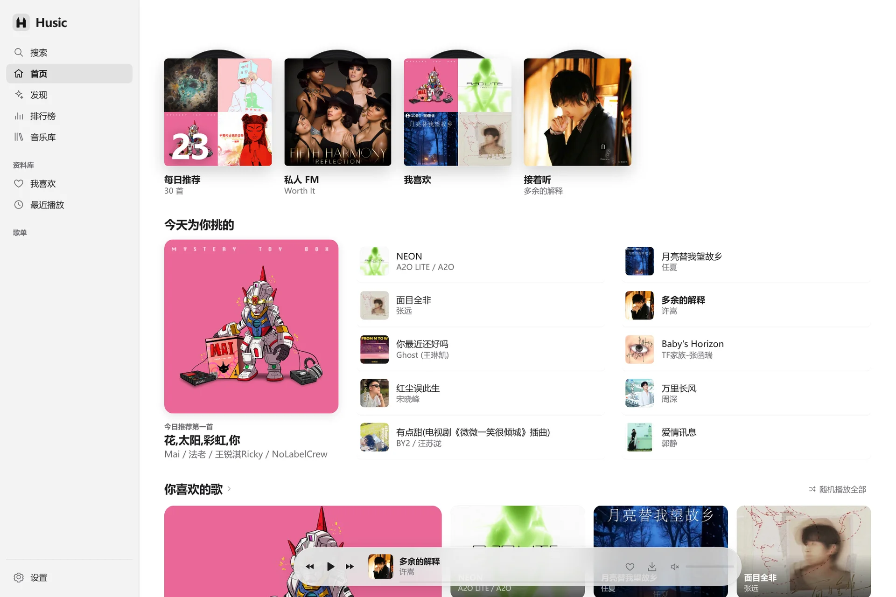
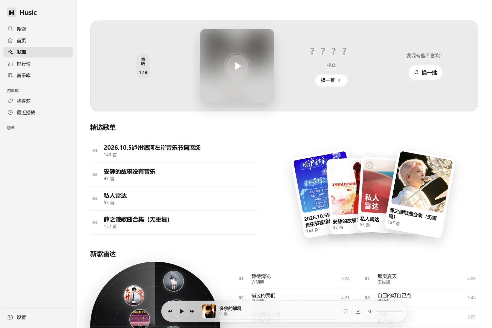
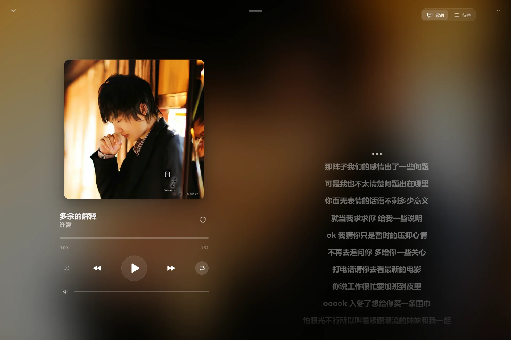
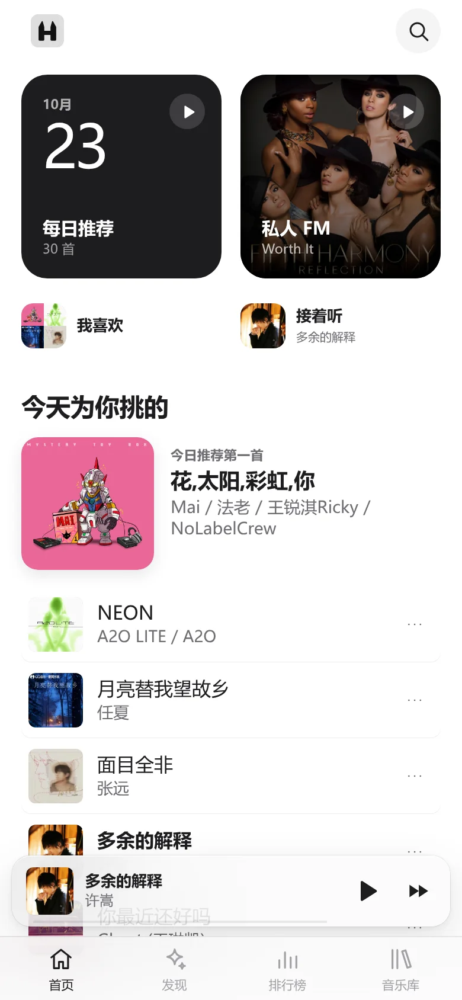

# Husic

一个可自部署的个人音乐播放器。把多平台歌曲、推荐、歌单和同步歌词放在一起，支持电脑网页、手机网页和轻量 Windows 客户端。



[部署自己的实例](#本地运行) · [Windows 客户端](#windows-客户端) · [下载与发行记录](https://github.com/hardware661/Husic/releases)

## 功能

- 聚合网易云、QQ 音乐、酷我、酷狗和咪咕的公开内容，播放时自动寻找可用版本。
- 搜索建议与可删除历史、发现、电台、排行榜、收藏、歌单（含重命名）和播放历史。
- 待播拖动排序；播放栏一键下载、歌单全部下载、下载管理、本地导入与离线音频播放。
- 网易云与 B站扫码连接；YouTube Music 使用独立的可续期会话。
- 网页和手机布局、完整播放页、同步歌词与不中断的队列播放。
- 定时停止播放：小时、分钟、秒滚轮，支持取消和重新计时。
- Windows 托盘、媒体控制、透明桌面歌词、横竖排与可选副歌词。
- 深浅外观、自选色系、本机背景图和歌单封面。

未连接音乐账号时仍可浏览和播放公开内容；会员歌曲、个人推荐及平台私有收藏取决于相应账号和平台权限。

## 界面预览

**发现** · 先听再揭晓的盲听、扇形歌单与新歌雷达。



**播放与歌词** · 封面取色背景、同步歌词与待播队列。



**手机** · 双列首页入口、悬浮播放条与底部导航。



截图来自当前应用界面，使用公开曲目与演示音乐库，不包含私人账号或歌单。源码主分支包含后续改动，发行附件以对应版本标签为准。

## 发行方式

Husic 以自部署项目发行。源码包含后端、网页和 Windows 客户端；部署者自行运行后端与 PostgreSQL，并在自己的实例中连接音乐账号。项目不提供公共音乐服务，也不内置维护者的服务器、账号或会话。

部署后可直接通过电脑或手机浏览器使用。Windows 客户端是可选入口，提供托盘和桌面歌词。公开绿色包默认连接本机 `http://127.0.0.1:18788`，不附带后端或数据库；连接自己的 HTTPS 实例时，按下文指定地址构建客户端。

## 本地运行

后端使用 Go，网页使用 React，Windows 客户端基于 WebView2。需要 Go 1.26.10、Node.js 22 或更新版本，以及 PostgreSQL。依赖版本由 `go.mod` 和 `web/package-lock.json` 锁定。

```bash
cd web
npm ci
npm run build
cd ..
go build -o bin/husic ./cmd/husic
mkdir -p .local/accounts
chmod 700 .local
```

将 PostgreSQL 连接串写进 `.local/db.url`，权限设为 `600`；不要把它提交到仓库。程序启动时自动应用数据库迁移。

```bash
./bin/husic -listen 127.0.0.1:18788 \
  -db-file .local/db.url \
  -account-state .local/accounts \
  -web web/dist
```

打开 `http://127.0.0.1:18788`，音乐账号可在设置里连接。无需先准备网易云账号。

本地开发可用 `npm run dev` 启动前端。需要国内出口时，后端的 `-cn-proxy` 支持 HTTP、SOCKS5/SOCKS5h；不修改系统代理。部署到服务器时，请使用自己的 HTTPS 反向代理与访问认证；可通过 `-gateway-header`、`-gateway-key-file` 校验网关证明。完整参数见 `./bin/husic -h`。

**这是个人实例，不是多用户音乐服务。** 收藏、歌单和平台连接属于整个后端实例，不按访问者隔离。不要把个人实例的 API 无认证公开给别人。

## Windows 客户端

Windows 10/11 x64，需要系统已有 Microsoft Edge WebView2。客户端只有一个播放器，不另起一份音频或后台服务。

```text
python desktop/fetch-sdk.py
powershell -NoProfile -ExecutionPolicy Bypass -File desktop/build.ps1
```

构建使用 Windows 自带的 .NET Framework C# 编译器，不要求另装 .NET SDK 或 Rust。WebView2 SDK 下载到项目内并校验锁文件里的 SHA256。

默认客户端连接 `http://127.0.0.1:18788`，不带任何私人站点或统一登录。连接自己的 HTTPS 服务可用：

```powershell
./desktop/build.ps1 -ServerOrigin https://music.example.com
```

只有实例另设独立网页登录门户时才指定 `-LoginOrigin https://login.example.com`。HTTP 仅允许本机回环地址。

生成的 `desktop/dist/Husic.exe` 为绿色客户端。默认关闭收进托盘；真正退出使用托盘菜单。原生壳升级需退出后重开；网页更新随服务器同步。客户端数据保留在 `%LOCALAPPDATA%\Husic`。

## 图片与连接

音乐库的“本地导入”支持常见 WAV、MP3、FLAC、AAC，以及运行环境支持的 M4A、OGG、OPUS、WEBM。文件保持原编码，不转码、不上传；元数据和音频副本保存在当前设备的 IndexedDB。

歌曲菜单的“下载”保存当前可用的完整音频，进度、取消和失败重试位于“下载管理”。已保存的副本可以断网播放或另存为；移除只删除应用内副本，不删除原始文件或另外导出的文件。每份音频上限 512 MB，会员和内容可用性仍取决于原平台。

歌单页的“全部下载”按顺序保存当前歌单，跳过已下载、重复和已在本地的曲目，个别失败继续下一首。总进度和取消位于下载管理；本机存储不足会停止后续下载。完整音频最终保存在当前设备的 Husic 本地库，后端只用临时文件中转与校验，传送结束后删除；需要普通音频文件时，可在下载管理选择“另存为”。

背景图、自定义歌单封面只保存在当前浏览器或客户端设备，不上传音乐平台，不自动跨设备同步。上传接受 JPG、PNG、WebP、AVIF，并限制大小和像素数。

YouTube 通过独立会话和项目指定的 yt-dlp / Deno 工具接入，不提供公开的 Premium 播放 OAuth API。连接可能过期；YouTube 连接助手应只安装在用户自己的 Chrome 中。客户端不会读取日常浏览器的 Cookie。连接助手默认只匹配本地实例；自托管 HTTPS 站点用 `python connect/build.py --origin https://music.example.com` 生成对应的扩展包。

账号会话、数据库、浏览器 Profile、客户端运行目录和个人部署记录都不属于公开源码包。

## 验证

```bash
go test ./...
go vet ./...
npm --prefix web run check
npm --prefix web run build
```

Windows 隔离检查：`desktop/test.ps1 -LyricsOnly`、`-SecondaryOnly`、`-RestoreOnly`、`-AudioOnly`。检查使用独立 Profile 和静音音频，不使用真实账号。

前端浏览器回归的运行方式见 [web/tests/README.md](web/tests/README.md)，覆盖桌面与手机布局、失焦恢复、歌单操作、下载和定时停止。

## 许可

[MIT](LICENSE)。Microsoft WebView2 等第三方组件保留各自许可；SDK 许可随绿色包提供。本许可仅覆盖 Husic 自身代码，不授予音乐内容或第三方服务的权利。
